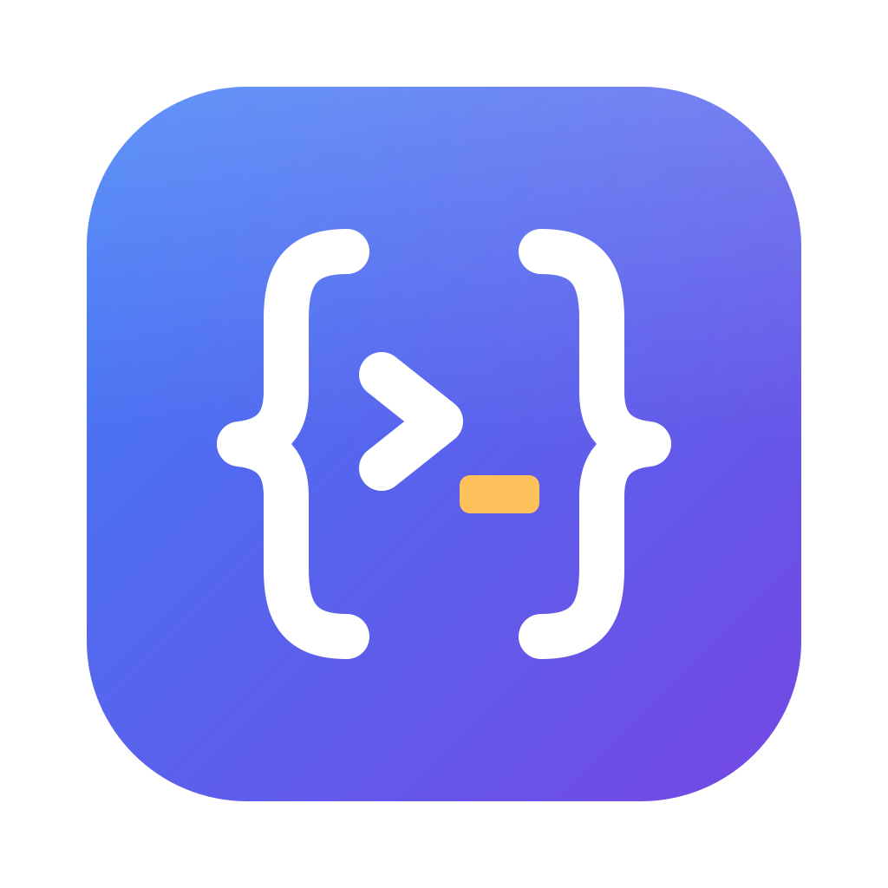
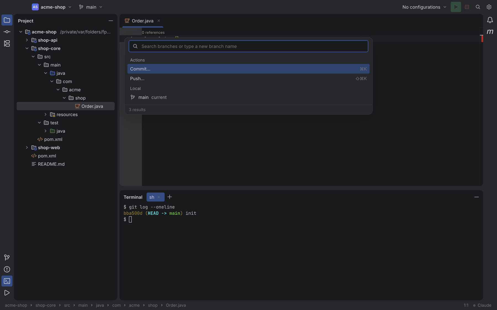

<p align="center">
  
</p>

<h1 align="center">AnyCode</h1>

<p align="center">
  Uma IDE leve, AI-first, para abrir todos os seus projetos (JS/TS, Java, Kotlin…) numa única janela.<br>
  O Claude Code escreve; você revisa, navega e executa.
</p>

<p align="center">
  
</p>

---

## Por quê

Quem trabalha com front-end e back-end acaba alternando entre WebStorm e IntelliJ IDEA o dia todo. E, com o Claude Code fazendo a maior parte da escrita, boa parte da IDE (debugger, refactorings profundos, plugins) quase não é usada. O que sobra é revisar diffs, navegar pelo código, rodar o projeto e commitar.

O AnyCode cobre exatamente isso:

- **Todos os projetos, como no IntelliJ.** Abra cada projeto numa aba (New Tab) ou na própria janela (New Window), e junte janelas em abas com Merge All Project Windows. Cada um tem abas, tool windows, terminais, execuções, servidores de linguagem e a própria sessão do `claude`. Troque entre eles com ⌥⌘\` ou pelo widget de projeto.
- **Claude Code como cidadão de primeira classe.** O terminal do agente abre por projeto e a sessão continua viva quando você troca de projeto. A IDE se conecta ao `claude` pelo mesmo mecanismo do `/ide` das extensões oficiais: diffs para aceitar ou rejeitar, seleção atual, arquivos abertos e diagnostics.
- **Memória muscular do IntelliJ.** O keymap padrão do IntelliJ para macOS é carregado direto dos XMLs originais, com os mesmos action IDs. ⇧⇧, ⌘B, ⌘E, ⌘K, ⌃R e ⌥F12 fazem o que você espera.
- **Visual Islands Dark.** Cores, ícones e layout do IntelliJ New UI, com JetBrains Mono no editor e Inter na interface.

## O que tem

| Área | Recursos |
| --- | --- |
| **Editor** | Monaco com abas, Go to File / Recent Files / Search Everywhere / Find Action, Structure, Problems |
| **Linguagens** | TypeScript/JavaScript via [typescript-go](https://github.com/microsoft/typescript-go), Java via jdtls e Kotlin via kotlin-lsp: erros, ⌘B, hover e completion. ESLint do próprio projeto. |
| **Claude Code** | Terminal do agente por projeto e bridge IDE ↔ Claude (`openDiff`, `getDiagnostics`, `selection_changed`…) |
| **Git** | Commit com checkboxes e commit parcial, Commit and Push, Rollback, Log com filtros e diff por commit, popup de branches (checkout, criar branch), cores de status na árvore |
| **Run** | Run configurations de Spring Boot, Maven, npm, Gradle, Shell e JUnit, compatíveis com `.run/*.run.xml` e importadas do `.idea/workspace.xml`; CodeLens "▶ Run" em testes |
| **Maven** | Tool window com reator, lifecycle, perfis, plugins e árvore de dependências; módulos e source roots marcados na árvore do projeto |
| **Markdown** | Preview com os layouts do IntelliJ e blocos de shell executáveis no terminal |
| **Settings** | Fonte do editor, shell e comando do agente, status dos servidores de linguagem, keymap pesquisável |

Ficam fora, de propósito: debugger, profiler, ferramentas de banco, refactorings semânticos profundos e plugins. Leia os princípios de produto no [`CLAUDE.md`](CLAUDE.md).

## Começando

Requisitos: macOS (Apple Silicon), Node 24, `git` e o [Claude Code](https://github.com/anthropics/claude-code) instalado.
Para Java/Kotlin, também Java 21+.

```bash
npm install
node node_modules/electron/install.js   # o Electron baixa o binário sob demanda
npm run dev                              # abre a IDE no projeto atual
```

Servidores de Java e Kotlin (opcionais, baixados com verificação de SHA-256):

```bash
node scripts/install-language-servers.mjs jdtls kotlin
```

Gerar o `AnyCode.app`:

```bash
npm run package:dir   # dist/mac-arm64/AnyCode.app
npm run package       # .dmg e .zip
```

O app usa assinatura ad-hoc e serve para uso local, sem notarização.

## Desenvolvimento

```bash
npm run typecheck
npm run lint
npm test            # Vitest
npm run test:e2e    # Playwright _electron, headless (nenhuma janela aparece)
npm run screenshot  # captura headless em out/screenshots/main.png
```

| Pasta | Conteúdo |
| --- | --- |
| `src/main/` | Processo main: projetos, fs, PTY, LSPs, git, Maven, run configurations e o servidor MCP do bridge |
| `src/preload/` | Ponte IPC tipada (`contextBridge`) |
| `src/renderer/` | UI em React: workbench, editor, keymap, tema, terminal, tool windows |
| `src/shared/` | Contratos de IPC e tipos usados pelos dois lados |
| `e2e/` | Testes Playwright, cada um num projeto temporário |
| `resources/intellij-community/` | Keymaps, tema e ícones do intellij-community (Apache-2.0) |

Stack: Electron, TypeScript strict, React, Vite (electron-vite), Monaco, xterm.js e node-pty.

## Créditos

Keymaps, tema e ícones vêm do [JetBrains/intellij-community](https://github.com/JetBrains/intellij-community) (Apache-2.0), com atribuição em [`THIRD_PARTY_NOTICES.md`](THIRD_PARTY_NOTICES.md). A referência do protocolo do bridge é o [coder/claudecode.nvim](https://github.com/coder/claudecode.nvim) (MIT).
AnyCode não é afiliado à JetBrains nem à Anthropic.
